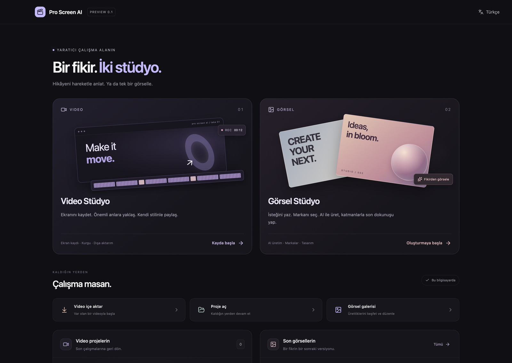
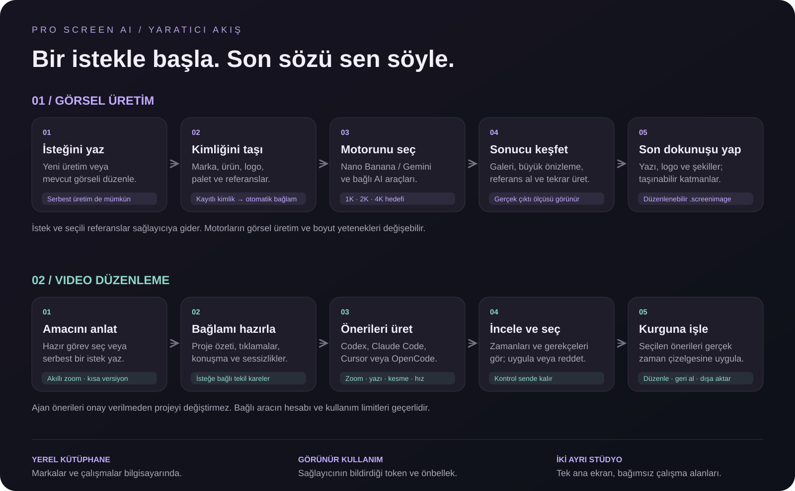
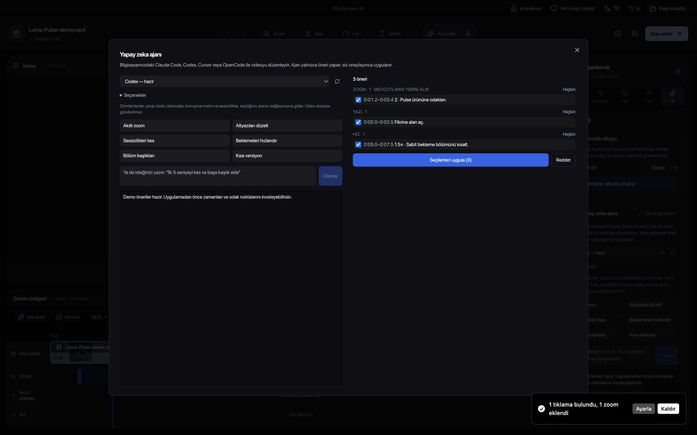
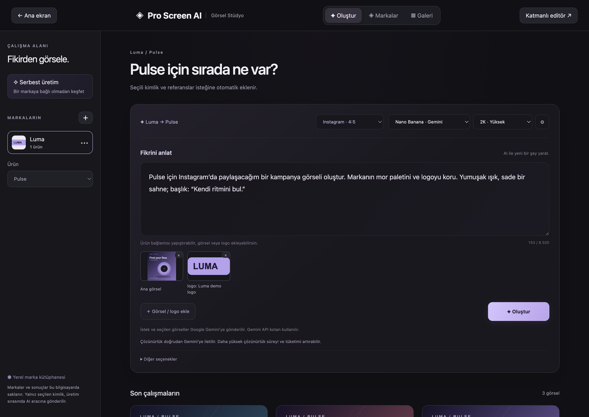
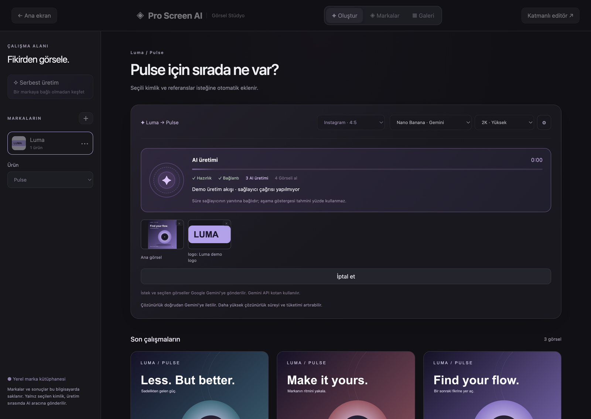
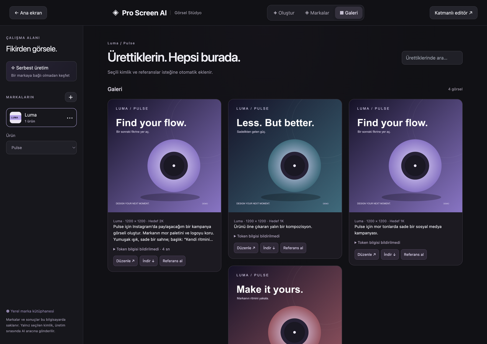
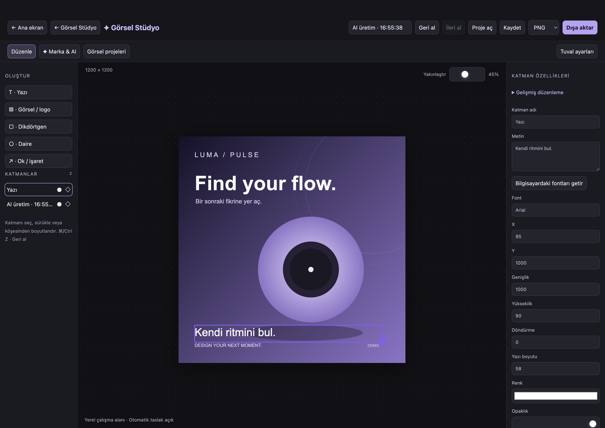
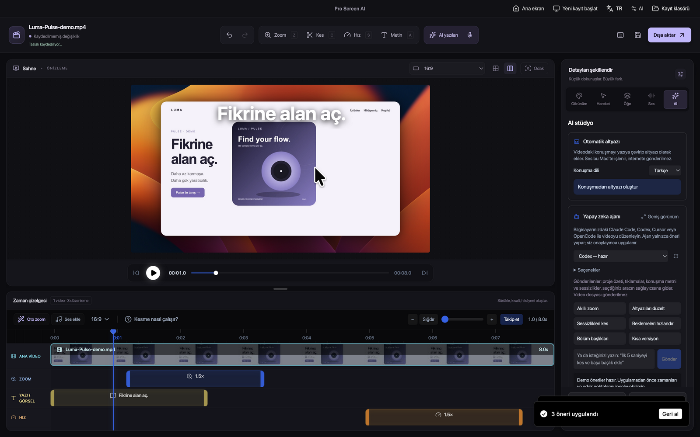

<div align="center">

# Pro Screen AI

### Bir fikir. İki stüdyo.

**Ekranından bir hikâye. Markandan bir görsel.**<br />
Video kaydı, kurgu, marka kimliği ve yapay zeka üretimini aynı masaüstü uygulamasında buluştur.

**Electron + React + TypeScript** · **macOS / Apple Silicon** · **Geliştirme sürümü 0.1**

[Görsel Stüdyo](#görsel-stüdyo) · [Video Stüdyo](#video-stüdyo) · [Yapay zeka akışı](#yapay-zeka-nasıl-çalışıyor) · [Kurulum](#kurulum) · [Gizlilik](#verilerin-ve-anahtarların)

</div>



> **Ekran görüntüleri gerçek uygulama arayüzünden alındı.** Luma / Pulse sentetik demo içeriğidir. Görsel örnekler SVG ile hazırlanmıştır; üretim ilerlemesi ve AI önerileri demo yanıtları kullanır. Bunlar model kalitesi, token maliyeti veya üretim süresi ölçümü değildir. Kişisel veri ve gerçek API anahtarı kullanılmadı. [Görsellerin nasıl hazırlandığı →](docs/media/README.md)

## Pro Screen AI yaklaşımı

Tek bir projeye her şeyi sıkıştırmak yerine, amacına göre bir çalışma alanı seçersin. Video için zaman çizelgesi; görsel üretim için istek alanı, marka kütüphanesi ve galeri. Gerektiğinde katmanlı editöre geçersin.

| Öne çıkan akış | Sana ne kazandırır? |
| --- | --- |
| **Marka → ürün → üretim** | Logoyu, paleti ve ürün referanslarını bir kez tanımla. Sonraki isteklerde seçili kimlik otomatik taşınsın. |
| **Tek istek, hazır bağlam** | Uzun bir form doldurmadan isteğini yaz. Serbest üretim yap veya kayıtlı bir markayla çalış. |
| **AI önerir, sen uygularsın** | Video ajanının zoom, kesme, hız ve yazı önerilerini zamanlarıyla incele; seçtiklerini uygula. |
| **Kendi AI aracını seç** | Video için Codex, Claude Code, Cursor veya OpenCode; görsel için Nano Banana / Gemini ve bağlı araçlar. Yetenekler araca ve hesaba bağlıdır. |
| **Üretimden düzenlemeye devam et** | Galerideki sonucu büyüt, referans olarak kullan veya yazı, logo ve şekillerle katmanlı düzenle. |
| **Kullanımı görünür kıl** | Bildirilen token, önbellek ve süre bilgilerini görüntüle. Hedef çözünürlüğü gerçek çıktı ölçüsüyle karıştırma. |

## Yapay zeka nasıl çalışıyor?



### Bir markayı tekrar tekrar anlatma

Örneğin Luma markasını ve Pulse ürününü seçtikten sonra şu kadarı yeterli:

> “Pulse için Instagram’da paylaşacağım bir kampanya görseli oluştur. Markanın mor paletini ve logoyu koru. Başlık: Kendi ritmini bul.”

Kayıtlı marka bilgileri ve seçili referanslar isteğe eklenir. İstersen bağlantı paylaşabilir veya yeni bir görsel ekleyebilirsin. Dahili marka/görsel yönergeleri; ürün geometrisi, logo, renk ve metin tutarlılığını promptta tarif eder. Modelin bunlara kusursuz uyacağı garanti edilmez; son kontrol kullanıcıdadır.

### Videoda niyetini anlat, önerileri incele

> “Ürüne yaklaş, bekleme bölümünü hızlandır ve başa kısa bir başlık ekle.”

Ajan, proje özeti ve izin verilen bağlamla çalışır. Öneriler doğrudan projeyi değiştirmez: zamanları, metinleri ve gerekçeleri görür; seçtiklerini uygularsın. Sonrasında normal düzenleme ve geri alma araçlarını kullanabilirsin.



| AI özelliği | Kullanılan yol | Bilmen gereken |
| --- | --- | --- |
| Görsel üretimi / görseli düzenleme | Nano Banana · Gemini API | Kendi Gemini anahtarın; sağlayıcı erişimi ve kotası gerekir. |
| Bağlı araçla görsel çalışması | Codex ve algılanan diğer araçlar | Her aracın veya hesabın gerçek görsel dosyası üretme desteği olmayabilir. |
| Video düzenleme ajanı | Codex / Claude Code / Cursor / OpenCode | Bilgisayarında kurulu ve oturum açılmış araç gerekir. Önerileri sen onaylarsın. |
| Marka kimliği taslağı | Web sitesi çıkarımı + bağlı AI aracı | Ana sayfa bilgisi, uygun logo adayları, renkler ve tipografi toplanır; sonucu kaydetmeden önce düzenlersin. |
| Video için kısa yazılar | Modelion | Konu ve üsluba göre zamana yayılan düzenlenebilir yazılar. Konuşma dökümü değildir. |
| AI seslendirme | Modelion · Ema Lightning | Yazdığın veya oluşturulan metni seslendir, önizle, ses kanalına ekle. |
| Otomatik altyazı | Apple cihaz içi konuşma tanıma | macOS 26+, desteklenen dil ve indirilmiş model varlıkları gerekir. Ses bu akışta bulut transkripsiyonuna gönderilmez. |

## Görsel Stüdyo

### İsteğin merkezde, marka kimliğin yanında

Serbest üretim alanında bir fikri tarif et. Ya da kayıtlı markanı ve ürününü seç: logo, referanslar, renk paleti, iletişim tonu ve görsel dil üretim bağlamına taşınır.



- **Kalıcı marka kütüphanesi:** birden çok marka; her marka altında ürünler ve rolü belirlenmiş logo, ürün ve tarz görselleri.
- **Web sitesinden başlangıç:** ana sayfa metni, SVG/PNG logo adayları, renkler ve font bilgileriyle düzenlenebilir kimlik taslağı. Site yapısına göre sonuç eksik kalabilir.
- **Geri alınabilir marka silme:** silinen markaları geri yükle; ürün ve galeri ilişkilerini koru.
- **Kullanım yerine göre oran:** kare 1:1, Instagram 4:5, Story/Reels 9:16, yatay 16:9 veya istekte tanımlanan kullanım.
- **1K / 2K / 4K seçimi:** Gemini hattında çözünürlük ayarı API'ye iletilir. Bağlı araçlarda hedef olarak aktarılır; dosyanın gerçek ölçüsü galeride gösterilir.
- **Ayrı bağlantı ayarları:** anahtarı üretim formunda her seferinde yeniden girmen gerekmez.

### Üretim sürecini takip et

Bağlantı, üretim ve dosyanın alınması gibi aşamalar animasyon ve geçen süreyle gösterilir. Tamamlanınca sağlayıcının bildirdiği kullanım bilgileri sonuca bağlanır. Sabit bir token fiyatı veya yapay bir ilerleme yüzdesi vaat edilmez.



**Token toplamı tek başına maliyet değildir.** Özellikle ajanlarda toplam girdi, önbellekten gelen bağlamı içerebilir. Arayüz bildirilen girdi, çıktı, önbellek ve yeni girdi ayrımını gösterir. Bilgi gelmediyse sıfır tüketim varsayılmaz. Daha yüksek çözünürlük süreyi ve tüketimi artırabilir; kesin etki motor ve hesaba bağlıdır.

### Galeri bir sonraki üretimin başlangıcı

Sonuçlarını marka/ürün bazında bul, büyük önizlemede incele, indir veya yeni isteğe referans yap. Galeri, görseli zorla bir tasarım tuvaline yerleştirmez.



### Son dokunuşlar için katmanlı editör

Üretilen görselin üstüne yazı, logo, resim ve şekiller ekle. Katmanları taşı, boyutlandır, döndür; sırala, kilitle veya gizle. Bilgisayardaki fontlarla çalış, hizalama ve geri alma araçlarını kullan.



`.screenimage` proje dosyasıyla düzenlenebilir çalışmanı sakla; PNG, JPEG veya WebP olarak dışa aktar. Uygun formatta şeffaf arka plan kullanabilirsin. Font dosyaları projeye gömülmez; başka bilgisayarda aynı fontun kurulu olması gerekir.

## Video Stüdyo

Ekranını veya seçtiğin alanı kaydet. İstersen mevcut videoyu içe aktar; önizleme, zaman çizelgesi ve sekmeli ayar paneliyle kurgunu oluştur.



| Kayıttan paylaşıma | Özellikler |
| --- | --- |
| **Yakalama** | Ekran / pencere / alan seçimi; mikrofon ve desteklenen sistem sesi; kayıt sırasında kompakt kontrol çubuğu. |
| **Hareket** | Cursor verisiyle otomatik zoom, manuel zoom alanları, yumuşatılmış imleç ve tıklama efektleri. |
| **Kurgu** | Ayrı ana video, zoom, yazı/görsel, hız ve ses kanalları; kesme, hassas zamanlar ve klavye kısayolları. |
| **Görünüm** | Hazır stiller, arka plan/gradient, gölge, iç boşluk, yuvarlatılmış köşeler ve farklı sahne oranları. |
| **Ses ve AI** | Ses kanalı düzenleme, AI yazıları, Ema Lightning seslendirme, yerel altyazı ve incelemeli ajan önerileri. |
| **Dışa aktarma** | Çözünürlük ve FPS ayarlarını aktarmadan önce seç; MP4 veya GIF çıktısı oluştur. |
| **Devamlılık** | Son projeler, otomatik taslak/kurtarma akışları, atomik kayıt ve kaydedilmemiş değişiklik kontrolü. |

Video ve görsel çalışma alanlarında görünür **Ana ekran** düğmesi vardır. Katmanlı editörden ayrıca **Görsel Stüdyo** ekranına dönebilirsin.

## Verilerin ve anahtarların

**Yerel kütüphane, tamamen çevrimdışı AI anlamına gelmez.** Markalar, projeler ve galeri bilgisayarında saklanır; AI isteğinde seçilen sağlayıcıya gerekli bağlam gönderilir.

| Veri | Nasıl ele alınır? |
| --- | --- |
| Marka, ürün, logo, galeri | Yerel kütüphanede saklanır. Seçilen kimlik ve referanslar üretim isteğine eklenir. |
| Görsel isteği ve referanslar | Seçtiğin API sağlayıcısına veya bağlı aracın sağlayıcısına gider. |
| Video ajanı bağlamı | Proje özeti, tıklamalar, konuşma/sessizlik bilgileri; izin verirsen tekil video kareleri. Ham video dosyası ajan isteğine eklenmez. |
| Gemini / Modelion anahtarları | İşletim sistemi güvenli depolaması uygunsa şifreli saklanır; uygun değilse oturumla sınırlı tutulur. Proje dosyasına yazılmaz. |
| Kaynak GitHub deposu | Uygulama kodunu içerir. Kişisel galeri, kayıtlar, API anahtarları, `.env`, build/test çıktıları ve yerel proje dosyaları dışarıda tutulur. |

**GitHub'a kaynak kodunu göndermek, kişisel kütüphaneyi yedeklemez.** Marka/galeri için toplu taşınabilir yedekleme henüz tamamlanmadı. Video projeleri kaynak videoyu içine gömmez; dosyayı taşırken bağlantısını korumalısın.

Kaynak geçmişindeki kontrolün kapsamı ve yerelde kalan eski geçmişe ilişkin bulgu: [Güvenlik denetimi →](docs/GUVENLIK-DENETIMI-2026-10-23.md)

## Kurulum

### Gereksinimler

- Node.js **22 LTS veya üstü**, npm.
- Doğrulanan platform: **macOS / Apple Silicon**. Native yakalama yardımcıları macOS 14.0 hedefiyle derlenir.
- Native derleme için Xcode Command Line Tools; cihaz içi otomatik altyazı yardımcısını derlemek için macOS 26 SDK içeren Xcode gerekir.
- AI özelliğine göre bağlı CLI aracı veya kendi sağlayıcı anahtarın. Hesap erişimi, kota ve ücretler ilgili sağlayıcıya aittir.

```sh
git clone https://github.com/kancaba/Proscreenai.git
cd Proscreenai
npm ci
npm run build:native-helpers
npm run dev
```

`npm ci`, native Electron bağımlılıklarını yeniden derler. İlk ekran kaydından önce macOS **Gizlilik ve Güvenlik → Ekran Kaydı** iznini ver. İmleç/tıklama takibi için **Erişilebilirlik**, mikrofon kullanımı için mikrofon izni gerekir.

### Yerel macOS paketi

```sh
npm run build:app
open "release-source-fix/mac-arm64/Pro Screen AI.app"
```

Bu komut yerel kullanım için ad-hoc imzalı uygulama klasörü oluşturur. Genel dağıtım için Developer ID imzası ve notarization ayrıca yapılandırılmalıdır. Windows/Linux build scriptleri korunmuştur; bu sürümde aynı kapsamda test edilmemiştir.

## Geliştirici haritası

```text
src/components/
  launch/             Ana ekran, kayıt ve kaynak seçimi
  video-editor/       Zaman çizelgesi, önizleme, AI ve çıktı ayarları
  creative-studio/    Marka/ürün kütüphanesi ve görsel galerisi
  image-studio/       İstek alanı ve katmanlı editör
src/lib/agent/        Ajan protokolü, görevler, öneri doğrulama
electron/            Ana süreç, güvenli anahtar deposu ve sağlayıcı bağlantıları
electron/native/     macOS yakalama, cursor ve konuşma yardımcıları
scripts/             Masaüstü doğrulama ve dokümantasyon araçları
docs/                Tasarım kararları, durum ve kabul notları
```

```sh
npm run typecheck
npm test
npm run i18n:check
python3 scripts/audit-secrets.py
```

Dokümantasyon ekran görüntülerini yeniden üretmek için:

```sh
npx vite build
node_modules/.bin/electron scripts/readme-screenshots.cjs
```

Masaüstü testleri ve ekran görüntüsü aracı izole profillerle çalışır. Canlı sağlayıcı testi yapan bazı diğer scriptler hesap kotası tüketir; dosya başındaki açıklamalarını okuyarak çalıştır.

## Durum ve sınırlar

Pro Screen AI aktif geliştirmededir. Mevcut akışlar için birim ve Electron arayüz testleri bulunur; tüm cihazlar, sürücüler ve sağlayıcı hesapları için sorunsuz çalışma garantisi verilmez.

- Marka/galeri toplu yedekleme ve geri yükleme, tamamlanması gereken önemli bir alandır.
- AI sonucu istenen oran veya çözünürlükten sapabilir. Özellikle bağlı araçlarda hedef ölçü, çıktı garantisi değildir.
- Webcam bubble, bulut paylaşımı ve tüm işletim sistemlerinde eşdeğer kabul testleri tamamlanmış özellikler olarak sunulmaz.
- Görsel düzenleme katmanlıdır; profesyonel bir piksel/rötuş editörünün tüm araçlarını kapsamaz.

[Güncel kalan işler →](docs/KALAN-ISLER-2026-10-23.md) · [Son marka/çözünürlük/token geliştirmeleri →](docs/MARKA-SILME-COZUNURLUK-TOKEN-2026-10-23.md)

## Kaynak ve lisans

Kayıt ve video düzenleme temeli [Recordly](https://github.com/DougNix/recordly) / OpenScreen çalışmalarına dayanır. Proscreenai deposu, temiz güncel kaynak ağacıyla başlatılmıştır; kaynak projenin eski commit geçmişi bu depoya aktarılmamıştır.

MIT telif ve lisans bildirimleri [LICENSE](LICENSE), [LICENSE.md](LICENSE.md) ve [LICENSE-OpenScreen](LICENSE-OpenScreen) içinde korunur. Bağımlılık ve medya bildirimleri: [THIRD_PARTY_NOTICES.md](THIRD_PARTY_NOTICES.md). Kaynak projenin README'si: [docs/UPSTREAM_README.md](docs/UPSTREAM_README.md).
